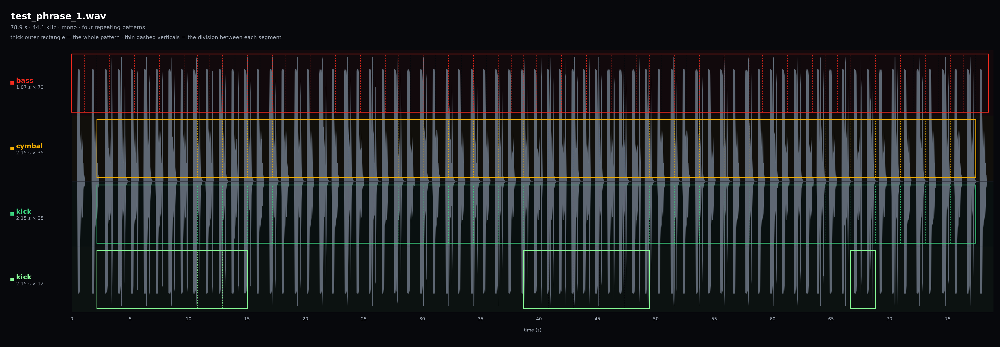

***Agents asked to use the analyze-palettes skill should ignore this document and everything in this directory entirely, using the algorithms as they exist in the skill itself.*** This directory is only for calibrating those algorithms beforehand. Agents tasked with doing this will be explicitly asked to work within this directory. 

## Definitions

- **Segment**: one iteration of a pattern — the audio between two adjacent
dashed lines. Every segment in a pattern is the same length, but different patterns can have different segment lengths, not necessarily multiples of each other. The dashes mark that uniform grid; they are not
measured beat positions.
- **Pattern**: a region that repeats at one fixed loop length **for at least three
segments**, running from its measured start to the end of its last complete
segment. The thick rectangle bounds it. Patterns are derived by tracking some distinct fundamental element that repeats in the same place in the segment, segment by segment. This could be an identifiably unique onset or a specific pitch that occurs in the same position in the segment. Patterns are independent of each other;
two patterns can share a segment length and still count separately because they are tracking different contents in their repetitions, i.e. an onset in one position of the segment (and/or timbre or pitch) versus another.
- **Phrase**: the full extent of the audio from the beginning to the end of all
of its overlapping patterns. 
- **Palette**: a full jam session recorded beginning to end with no editing. Palettes are analyzed for their patterns and have their phrases extracted before building the final song.
- **Stem**: a single instrument track of the final song. Stems are not relevant during this analysis step and only come into play later when the song is constructed.

## Purpose

Outlined in this document are calibration tests which the algorithm implemented in the analyze-palettes skill must pass. The goal is for that algorithm, whatever form it takes, to identify the exact segments, patterns and phrases detailed below from the given test_phrase.wav files also residing in this directory. In doing so the analysis should treat those test_phrase.wav files as if they were real palettes. 

Each test phrase below will have a key with the "correct" stats that should be derived from the audio. Floating point values such as segment lengths etc. do not need to match absolutely perfectly but they must be close. A discussion will also follow as to why the values in the key are the desired ones. It is essential to understand the intent and the purpose of these algorithms in order to build methods that will generalize to any palette seen in the future, and not just resort to any short-sighted solution that happens to generate the correct answers. 

## Reading the panel

- The gray trace is the same waveform drawn once per pattern, so every pattern
  has its own row against the shared time axis. The waveform is a single mono recording; every row comes from the same audio and nothing here is a stack of separate stems.
- The **thick outer rectangle** is the whole pattern: from its measured start to
  the end of its last complete segment.
- The **thin dashed verticals** divide the row into segments, one per loop
  iteration, at the pattern's loop length.
- The row label gives a subjective description of the element being tracked (these are by no means standard and could be anything that helps orient the listener to the pattern evident) and `loop × segments`.
  
# test_phrase_1.wav

## Results 

| Tracked element | Segment length (s) | Segments | Region (s) | Covered (s) |
|---|---:|---:|---|---:|
| bass | 1.07 | 73 | 0.00–78.11 | 78.11 |
| cymbal | 2.15 | 35 | 2.15–77.40 | 75.25 |
| kick | 2.15 | 35 | 2.15–77.40 | 75.25 |
| kick | 2.15 | 12 | 2.15–15.05, 38.65–49.40, 66.62–68.79 | 25.80 |

## Discussion 

1. **Unique tracked elements.** The most fundamental driver of any pattern is the unique element it is tracking. Again, these descriptions here (e.g., bass, etc.) are purely subjective. The point is that they are each uniquely characterizable by things like their onset, their timbre, their pitch, etc. For example, the bass and kick are both low frequency spectrally, but the kick has a much more staccato envelope and so both are distinct. Once a fundamental element has been characterized, it becomes a tracked pattern if it repeats at regular intervals throughout some portion of the recording.
2. **Even more defining than the tracked element itself is its position within the segment.** For example, we see there are two tracked elements labeled "kick". These are actually the exact same drum sample but they occur in different places within the segment length and therefore constitute distinct patterns. The first is on the downbeat and the second when it occurs is repeatedly a syncopated beat.
3. **A single tracked element can have non-contiguous patterns.** We can see that the second kick (the syncopated one) occurs in two separate patterns throughout the phrase. The segments of the patterns must be contiguous but any break in them can divide it into multiple patterns without issue. Of note here is that there could actually be considered a third pattern in this row at approximately 67 seconds to 69 seconds. However, that pattern has been excluded because it is only one segment length long and all patterns are required to be at least three segments long. 
4. **Starts are measured, not shared.** The bass begins at 0.00 s and the other
   two at 2.15 s, so the first 2.15 s hold the bass alone. Pattern starts come
   from the audio; they are not snapped to a common grid or to a pass loop
   point.
5. **Each pattern has its own uniform grid.** The bass divides every 1.07 s from
   0.00 s, the cymbal and kick every 2.15 s from 2.15 s; the rows' divisions do
   not line up, and no grid is imposed across patterns.
6. **The cycle count is an integer and the remainder is dropped.** 73 × 1.07 =
   78.11 s and 35 × 2.15 = 75.25 s. The recording is 78.9 s, so 0.79 s and
   1.50 s of tail sit outside the regions: a pattern ends at its last complete
   segment.
7. **The patterns are layers inside the one phrase, not sections.** The bass,
   cymbal and kick all run from 2.15 s to 77.40 s, which is what lets them stack
   in the song.

## Not in this panel

Pass assignment, raw lead-in and shifted entry, bar count, mean similarity and
confidence are recorded in the report's `summary.js` and the measurements table,
not drawn here. The panel shows only what was measured: loop length, segment
count and region.
