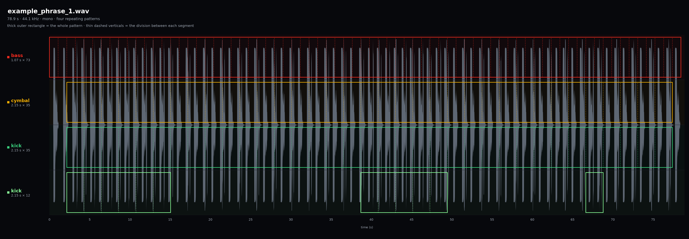

# example_phrase_1

A pattern analysis of one recording: **78.9 s · 44.1 kHz · mono · four repeating
patterns**. The panel is drawn from `example_phrase_1.wav` in this folder.

## Reading the panel

- The gray trace is the waveform, repeated once per pattern so every pattern has
  its own row against the same time axis.
- The **thick outer rectangle** is the whole pattern: from its measured start to
  the end of its last complete segment.
- The **thin dashed verticals** divide the row into segments, one per loop
  iteration, at the pattern's loop length.
- The row label gives the stem name (colored dot) and `loop × segments`.

## Measurements

| Pattern | Loop (s) | Segments | Region (s) | Covered (s) |
|---|---:|---:|---|---:|
| bass | 1.07 | 73 | 0.00–78.11 | 78.11 |
| cymbal | 2.15 | 35 | 2.15–77.40 | 75.25 |
| kick | 2.15 | 35 | 2.15–77.40 | 75.25 |
| kick | 2.15 | 12 | 2.15–15.05, 38.65–49.40, 66.62–68.79 | 25.80 |

Starts and ends are read off the axis to about ±0.05 s; covered time is
`segments × loop`.

## What the analysis shows

1. **Two loop lengths, in a 1:2 ratio.** The bass repeats every 1.07 s, the
   cymbal and kick every 2.15 s, so the bass turns over twice per cymbal cycle.
   This is a nested period, and the shorter loop is the one reported for the
   bass: its region genuinely repeats at half the others. If the bass loop is
   one bar (~1.07 s), the cymbal and kick loops are two bars.
2. **Patterns are per-region, not per-loop-length.** Two rows carry the same
   2.15 s loop but different regions: the 35-segment kick runs unbroken, the
   12-segment kick appears only in three separated stretches (6 + 5 + 1
   segments). Same length, different region, separate pattern.
3. **Starts are measured, not shared.** The bass begins at 0.00 s and the other
   two at 2.15 s, so the first 2.15 s hold the bass alone. Pattern starts come
   from the audio; they are not snapped to a common grid or to a pass loop
   point.
4. **Each pattern has its own uniform grid.** The bass divides every 1.07 s from
   0.00 s, the cymbal and kick every 2.15 s from 2.15 s; the rows' divisions do
   not line up, and no grid is imposed across patterns.
5. **The cycle count is an integer and the remainder is dropped.** 73 × 1.07 =
   78.11 s and 35 × 2.15 = 75.25 s. The recording is 78.9 s, so 0.79 s and
   1.50 s of tail sit outside the regions: a pattern ends at its last complete
   segment.
6. **The patterns are layers, not sections.** They overlap — all three stems run
   together from 2.15 s to 77.40 s — which is what makes them stack in the song.

## Not in this panel

Pass assignment, raw lead-in and shifted entry, bar count, mean similarity and
confidence are recorded in the report's `summary.js` and the measurements table,
not drawn here. The panel shows only what was measured: loop length, segment
count and region.
